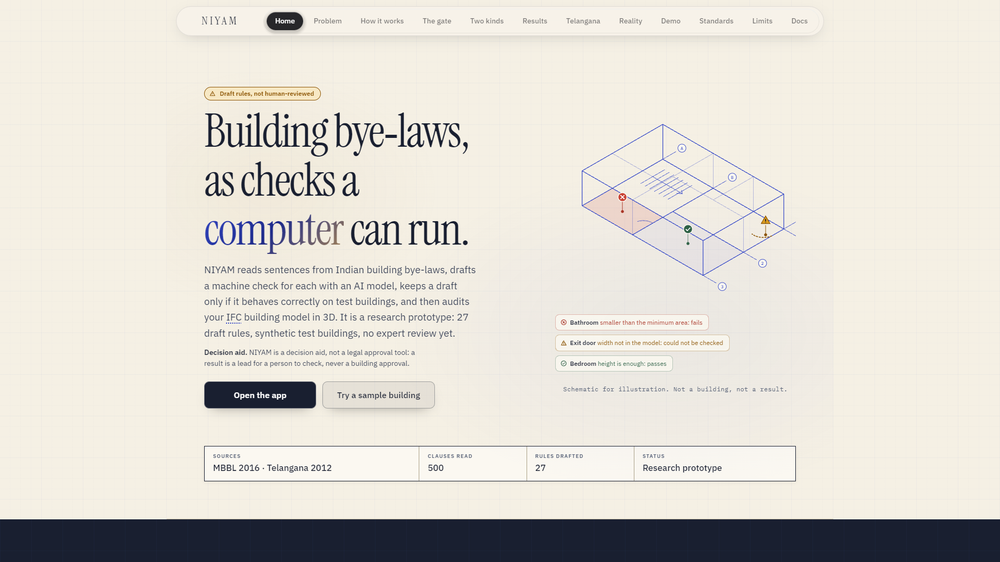
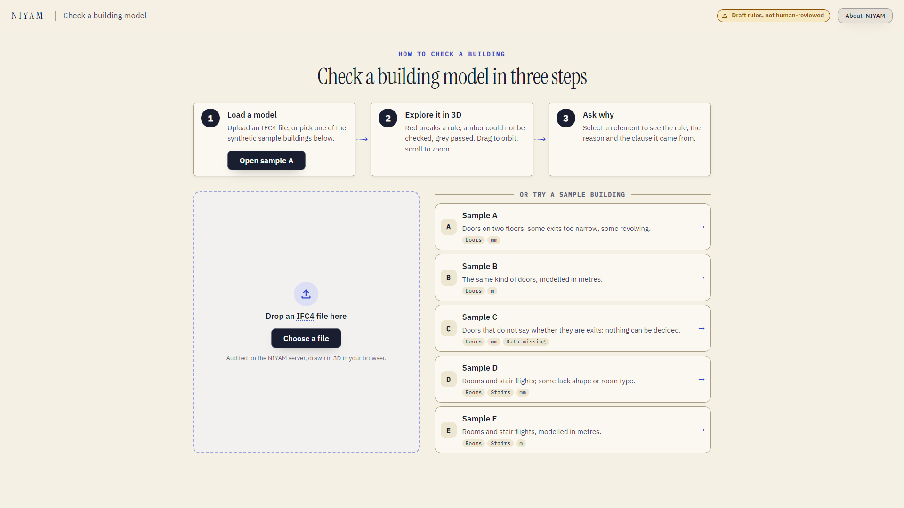
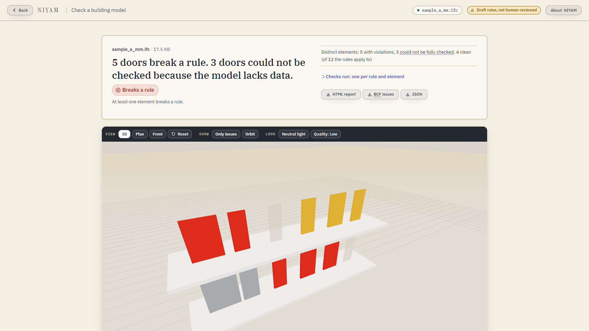
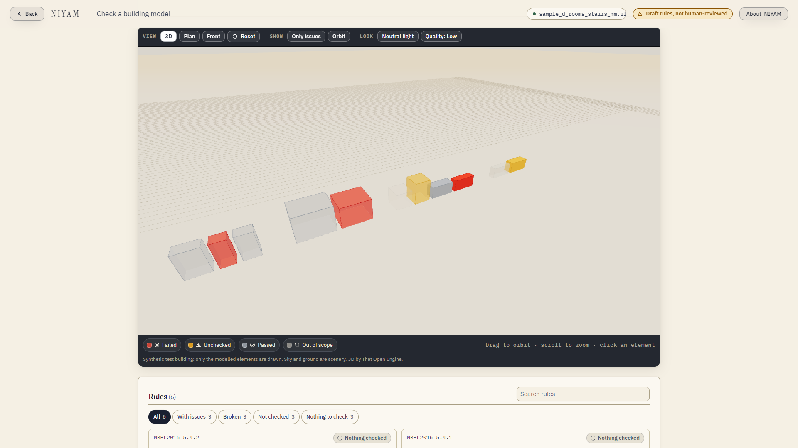
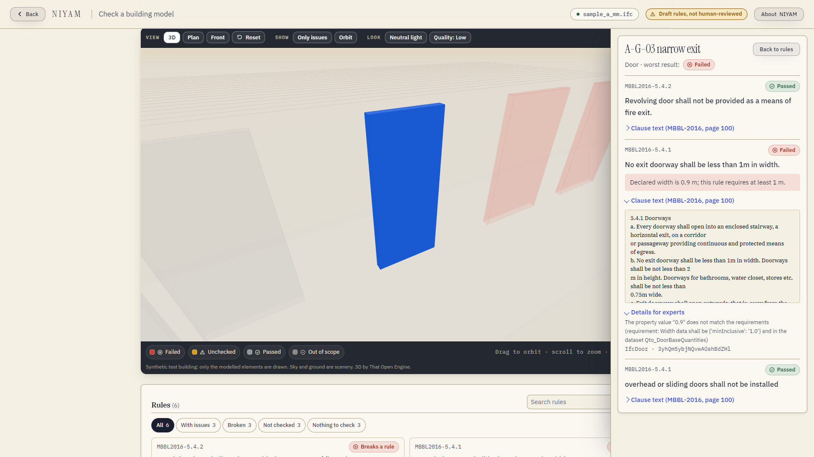
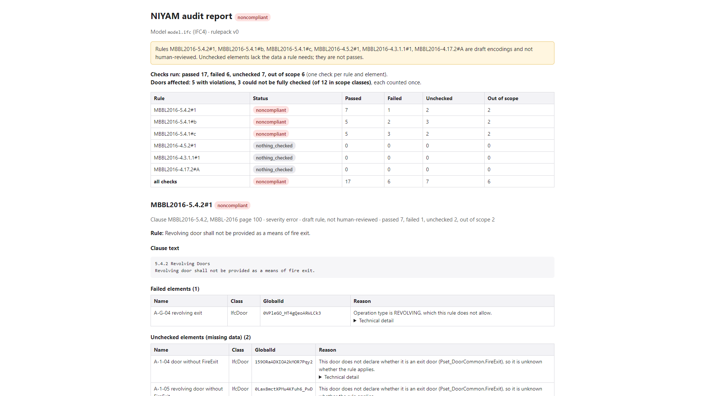
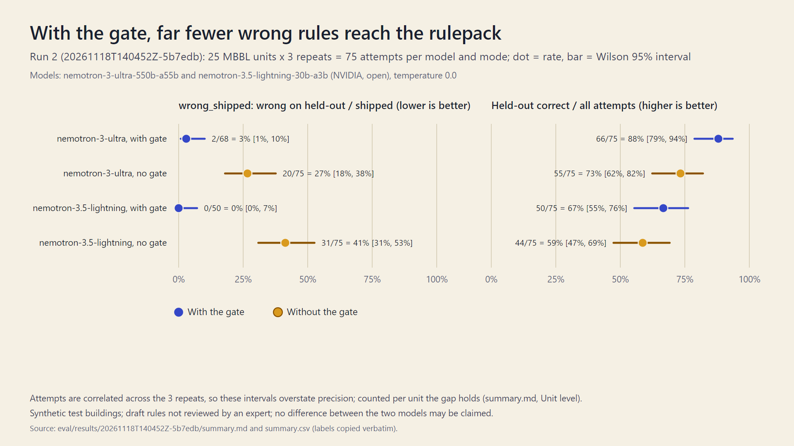
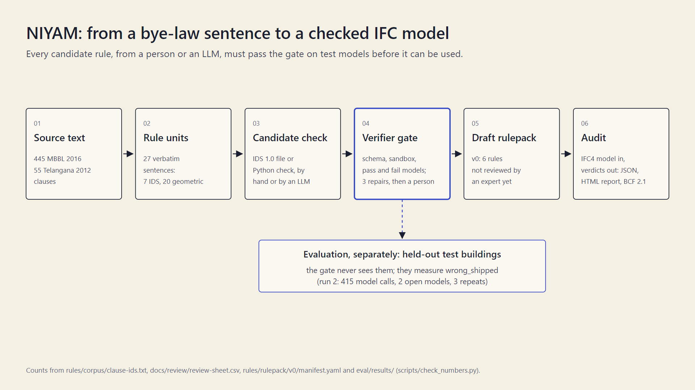

# Screens for the slides, in slide order

1920x1080 PNGs from one sequential Playwright run (`cd frontend; npx playwright test shots`), on NIYAM's synthetic
sample buildings. The two figures are SVG with a PNG render; their numbers are read from the committed results by
`python scripts/build_slide_figures.py` (run it before the screenshots). A 1440x900 set of 01 to 06 is in
`1440x900/`; the landing page's sheet A-09 uses copies of those.

| # | File | Shows |
|---|---|---|
| 01 | `01-landing-hero.png` | the landing page hero: what NIYAM is, the draft-rules badge and the decision-aid line |
| 02 | `02-start-screen.png` | the app's start screen: three steps, the drop zone and the sample cards |
| 03 | `03-verdict-sample-a.png` | sample A audited: the plain-language verdict above the 3D view |
| 04 | `04-sample-d-3d.png` | sample D (millimetres) at its real size, rooms and stair flights coloured by verdict |
| 05 | `05-selected-door-clause.png` | failing door A-G-03 selected, with the reason and the clause card (MBBL 2016, page 100) |
| 06 | `06-html-report.png` | the self-contained HTML report of sample A |
| 07 | `07-results-chart.png`, `07-results-chart.svg` | run 2: wrong_shipped and held-out correct, gated vs ungated, with Wilson 95% intervals |
| 08 | `08-pipeline.png`, `08-pipeline.svg` | the pipeline from bye-law sentence to audit, with the committed counts |

1440x900: `1440x900/01-landing-hero.png`, `1440x900/02-start-screen.png`, `1440x900/03-verdict-sample-a.png`,
`1440x900/04-sample-d-3d.png`, `1440x900/05-selected-door-clause.png`, `1440x900/06-html-report.png`.

